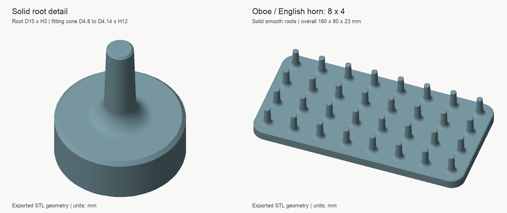

# 晾哨架

[[以中文阅读](README_CN.md) | [Read in English](README.md)]

参数化的双簧管、巴松、英国管哨片晾哨架 3D 模型。模型使用 [OpenSCAD](https://openscad.org/) 建模，主要针对 3D 打印。

## 种类

### 内嵌式晾哨架

内嵌式晾哨架通过内嵌的哨座槽放置哨片。这种晾哨架便于存放和携带，但不支持巴松哨片。详见 `recessed-reed-rack.scad`。

### 伸出式晾哨架

伸出式晾哨架通过短定位柱支撑哨片。打开 [protruding-reed-rack.scad](protruding-reed-rack.scad)，在 `ReedFamily` 中选择哨片类型：

- **`oboe_english_horn`（当前默认）**：双簧管／英国管共用底径 **4.8**、名义顶径 **4.14**、配合锥段长 **12 mm**，默认中心距 20 mm。
- `bassoon`：巴松，底径 5.4、名义顶径 4.0、配合锥段长 14 mm，默认中心距 24 mm。

柱底采用一体实心、连续圆滑的外扩根部，去除了十字槽和独立的直角止挡圆台。根部与底板、配合锥段平滑连接；顶部保留导入倒角。伸出式模型只需要原生 OpenSCAD；内嵌式模型仍使用 BOSL2。

根部默认高 **3 mm**、底部直径 **10 mm**（巴松为 12 mm）；上方配合锥段保留已选尺寸。锥段底径从根部上缘测量。根部不再有平面止挡，不同哨座会在圆滑过渡上的自然位置落座，停留高度可能与旧模型略有不同。顶部 0.3 mm 导入倒角会使末端平面直径比名义顶径再小 0.6 mm，共用版的末端平面直径为 **3.54 mm**。

当前完整架体为 [双簧管／英国管 STL](3D_files/mandrel-v2/rack-oboe-english-horn.stl)，8×4 布局，外形 **160 × 80 × 23 mm**。[巴松 STL](3D_files/mandrel-v2/rack-bassoon.stl) 外形 **192 × 96 × 25 mm**。原试配件几何保存在 `fit-tests/` 内，供历史对照；当前根部结构以主模型为准。尺寸来源和迭代记录见 [调研记录](docs/mandrel-research.md)。

`DiameterCompensation` 是直径补偿：正值加粗、负值减细。需要手动填写锥段底径、顶径和长度时，选 `ReedFamily="custom"` 后修改 `StapleBottomDiameter`、`StapleTopDiameter`、`StapleHeight`。`RootHeight` 控制加固根部高度，`RootDiameter=0` 使用对应乐器的默认根部直径，设为正值可自行指定。`StapleCenterSpacing` 是中心距，0 使用预设值。

FDM 打印时，建议重点检查柱子和根部的切片：0.4 mm 喷嘴可从 6 道壁开始，并对柱子／根部设置局部 100% 填充；底板不必全实心。几何上的实心并不等于切片后自动满填充。根部过渡意在减轻应力集中，实际抗折效果仍需打印验证。

同名 JSON 提供 OpenSCAD Customizer 的已命名预设。运行 `python3 scripts/validate-models.py` 可重新导出并检查六个 STL，输出到仓库原有忽略目录下的 `3D_files/mandrel-v2/`。所有 STL 按 mm、100% 比例打印。

旧的 `oboe` 参数名作为共用预设的兼容别名保留；`rack-oboe-a5.stl` 仅作历史对照，当前打印请选择上面的完整架体 STL。
